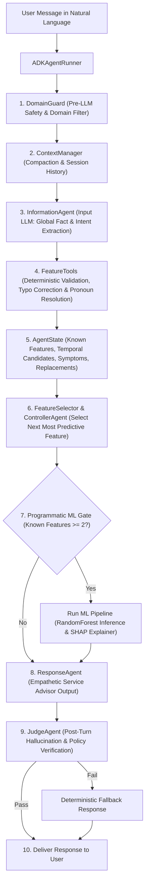

# AutoCare AI — System & Universal NLP Walkthrough

## 1. System Overview

**AutoCare AI** is a production-grade, conversational vehicle maintenance assessment application powered by the **Google Agent Development Kit (ADK)** and an authoritative **Random Forest** machine learning model.

### Key Architectural Tenet:
> **The user never has to adapt to the model's schema or categorical vocabulary. The system understands the user in natural language, while deterministic gates guarantee strict ML model input safety.**

---

## 2. Multi-Agent Architecture & Runtime Pipeline



---

## 3. Universal Natural-Language Intelligence Walkthrough

The conversational engine operates under the core principle:
> **"Understand first. Extract second. Validate third. Update state fourth."**

### Key Capabilities:

### A. Global Extraction (Unconstrained by Active Question)
- The user is **never** forced to answer only what was asked.
- If the AI asks about `Maintenance_History` and the user mentions *"I drove 45,000 kilometres and the car is 4 years old"*, the system extracts `Mileage = 45000` and `Vehicle_Age = 4`, while leaving `Maintenance_History` open for future turns.

### B. Coreference & Pronoun Resolution Across Turns
- Resolves anaphoric references (*"it"*, *"that"*, *"they"*) to antecedents in recent conversation history or the active question.
- **Example**:
  - AI asks: *"How would you describe your maintenance history?"*
  - User: *"It was done a year ago."*
  - The system resolves *"it"* $\rightarrow$ vehicle service event, logs service recency into `entity_observations`, generates a dynamic candidate interval into `temporal_candidates`, and keeps `Maintenance_History` open without incorrectly forcing it to `"Poor"` or `"Good"`.

### C. Relative Temporal Understanding Without Synthetic Date Fabrication
- Parses relative time expressions (*"one year ago"*, *"two years back"*, *"six months earlier"*, *"around Diwali"*, *"since last year"*, *"every six months"*) using dynamic runtime reference dates.
- Relative intervals are stored in `state.temporal_candidates` and `state.entity_observations`.
- **Safety guarantee**: Relative intervals are **never** fabricated into synthetic calendar dates in `feature_state["Last_Service_Date"]` (which strictly requires confirmed ISO `YYYY-MM-DD` dates).

### D. Component Condition vs. Symptom vs. Replacement History
- **Sensory Symptoms**: Descriptions like *"brakes feel spongy"*, *"brake pads squeaking"*, *"battery keeps dying"* are routed to `state.symptoms`. They are **never** mapped directly to physical wear categories like `Brake_Condition = "Worn Out"` or `Battery_Status = "Weak"`.
- **Past Maintenance Actions**: Past replacements (*"replaced tyres 3 months ago"*) are routed to `state.replacement_history`. They **never** reset `Vehicle_Age` or fabricate `Tire_Condition = "New"`.
- **Physical Wear**: Explicit descriptions of physical wear (*"brake pads are completely worn out"*, *"battery voltage is weak"*, *"tires have plenty of tread"*) map cleanly to canonical categories (`"New"`, `"Good"`, `"Worn Out"`, `"Weak"`).

### E. Automotive Typo Tolerance with Standard Library Fallback
- Normalizes spelling mistakes (*"battry"*, *"braks"*, *"servisd"*, *"maintanence"*, *"agoo"*) using RapidFuzz token matching against domain targets.
- Includes a resilient fallback to Python's standard library `difflib.SequenceMatcher` so the system never fails if dependencies are missing.
- Strictly preserves valid English syntax and vocabulary (`"stick shift"`, `"maintenance is good"`).

### F. Target-Specific Uncertainty vs. Active Question Uncertainty
- If the AI asks about `Maintenance_History` and the user says: *"I don't know when the battery was replaced"*, the system recognizes the uncertainty targets battery replacement history.
- The active question (`Maintenance_History`) remains unresolved and is **not** marked unknown.

---

## 4. Specification Examples Verification

The 5 exact examples from the Universal NLP specification are validated and verified:

```text
Example A:
User: "I replaced my tyres one year ago."
-> replacement_history["tires"]: "I replaced my tyres one year ago."
-> temporal_candidates: candidate interval ~1 year ago
-> Tire_Condition: unknown (does NOT assume tyre is in good condition)

Example B:
User: "My car has covered around 60 thousand kilometres."
-> Mileage: 60,000 km recorded in unverified_unit_features and observations.

Example C:
User: "The battery keeps dying, and I need to charge it frequently."
-> symptoms["battery"]: "The battery keeps dying, and I need to charge it frequently."
-> Battery_Status: unknown (no fabricated condition).

Example D:
User: "I don't know when I last changed the engine oil."
-> raw_observations: User expressed uncertainty regarding engine oil.
-> Last_Service_Date: unconfirmed (no fabricated date).

Example E:
User: "My car is four years old, has run 55,000 kilometres, and I replaced the battery last year."
-> Vehicle_Age: 4
-> Mileage: 55,000 km
-> replacement_history["battery"]: "replaced the battery last year"
```

---

## 5. Machine Learning & Preprocessing Invariants

- **Authoritative 19-Feature Schema**:
  - Categoricals (8): `Brake_Condition`, `Battery_Status`, `Tire_Condition`, `Maintenance_History`, `Fuel_Type`, `Transmission_Type`, `Owner_Type`, `Vehicle_Model`.
  - Numericals (9): `Reported_Issues`, `Vehicle_Age`, `Mileage`, `Odometer_Reading`, `Engine_Size`, `Fuel_Efficiency`, `Insurance_Premium`, `Service_History`, `Accident_History`.
  - Dates (2): `Last_Service_Date`, `Warranty_Expiry_Date`.
- **38-Column Preprocessor Matrix**:
  - `MaintenancePreprocessor` produces an exact $38$-column vector ($19\text{ values} + 19\text{ missingness indicators}$).
  - Categoricals mapped to ordinal integers (`0.0`, `1.0`, `2.0`); missing imputed to `-1.0` with `_missing = 1`.
  - Dates converted to ordinal timestamps; missing imputed to `-1.0` with `_missing = 1`.
- **Model Artifact**:
  - Trained `RandomForestClassifier` (`models/maintenance_model.joblib`, version 2.0.0).
  - Accuracy: 96.45% | Precision: 100.00% | ROC-AUC: 1.0000 | F1 Score: 0.9776.

---

## 6. Comprehensive Test Suite

The automated test suite contains **169 tests passing with 0 failures**:

```bash
# Run all automated tests
python -m pytest backend/tests/ -v

# Run Universal NLP tests
python -m pytest backend/tests/test_universal_nlp_intelligence.py -v
```

### Test Suite Breakdown:
1. `backend/tests/test_universal_nlp_intelligence.py` (32 tests):
   - Off-target service timing, coreference resolution, automotive typos, multi-attribute sentences, Specification Examples A–E.
   - Relative temporal normalization to ISO dates (`YYYY-MM-DD`) with approximation indicators (`is_exact: False`).
   - `"last year i did"` service timing recognition under `Maintenance_History` without guessing quality.
   - `"i just changed my battery 2 months ago"` replacement history and timing capture without asserting `"New"`.
   - `"battery is kind of old"` subjective/vague ambiguity detection without mapping to `"Weak"`.
   - `"brake is working properly"` mapping to `Brake_Condition = "Good"`.
   - `"approximately 5"` under `Service_History`, `Reported_Issues`, `Vehicle_Age` with `approximate_features` indicators.
   - `"no accidents"` mapping to `Accident_History = 0`.
   - Component age expressions (`"The battery is almost 3 years old."`) prevented from asserting `Vehicle_Age`.
   - Engine heating symptoms (`"The engine temperature rises during long drives."`) routed to `symptoms["engine"]`.
   - Unremembered service dates (`"I don't remember when I last serviced my car."`) recorded as `unavailable_features["Last_Service_Date"]`.
   - Natural language aliases (`"distance driven"`, `"number of services"`, `"number of accidents"`, etc.).
2. `backend/tests/test_adk_agents.py` (37 tests):
   - Multi-agent orchestration, hallucination guards, feature coverage across all 19 features.
3. `backend/tests/test_hypothesis_grounding.py` (19 tests):
   - Observation grounding, date normalization (`YYYY-MM-DD`), question plan boundary safety.
4. `backend/tests/test_agent.py` & `test_guards.py` (40 tests):
   - Domain filtering, prompt injection guards, turn loop prevention.
5. `backend/tests/test_ml.py` & `test_prediction_consistency.py` (27 tests):
   - 38-column transformation consistency, partial input inference stability.
6. `backend/tests/test_emergency_engine.py`, `test_emergency_flow.py`, `test_oauth.py` (14 tests):
   - Emergency detection, contact management, encrypted Google OAuth token storage.
